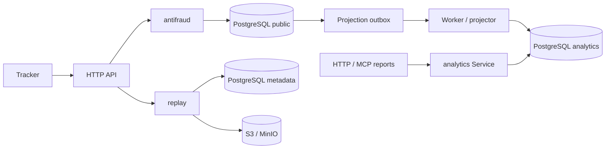

# Архитектурные изменения

Выбранный вариант: модульный монолит, PostgreSQL; проекции аналитики в отдельной
схеме `analytics`, обновляемые через transactional outbox. Replay — S3/MinIO,
в PostgreSQL только метаданные. Изменения не применяются к рабочей установке
автоматически: проверка и миграции выполняются на отдельной тестовой БД.

## Требования и проверка

- [x] Ревизия входных данных, согласованный снимок scoring, атомарный claim с
  lease; тесты конкурентного batch, двух worker, потери lease и ручной разметки.
- [x] Периодическое восстановление outbox, ограничение времени заданий,
  ожидание worker при остановке; тест восстановления и shutdown.
- [x] Модули antifraud, analytics, replay: бизнес-правила вне PostgreSQL,
  небольшие интерфейсы и тесты сценариев без БД.
- [x] Общий сценарий отчётов HTTP/MCP; тесты одинаковых параметров и результатов.
- [x] Batch-вставка событий и единый upsert сессии, без запросов на каждое
  событие; тесты retry, SPA, конфликтов владельца и атрибуции.
- [x] Суточные партиции raw_events, удаление истёкших партиций, ограниченная
  порционная очистка остальных данных; миграция старых данных и тест retention.
- [x] SessionContext одним запросом; сохранённое состояние признаков вместо
  перечитывания raw_events при каждом finalize; тесты эквивалентности, поздних
  событий и пересчёта после удаления raw_events.
- [x] Версия алгоритма, снимки конфигурации, контекста и признаков для каждой
  оценки; историческое воспроизведение отдельно от текущей переоценки.
- [x] S3/MinIO replay, миграция bytea, устойчивое удаление объектов, защита
  quota/retry; проверка настоящим MinIO и тесты ошибок хранилища.
- [x] Собственная схема аналитики без зависимости отчётов от OLTP-таблиц,
  отдельный пул и ограничение параллельности; доставка/повторная доставка,
  изменение классификаций, удаление, backfill и свежесть проекций.
- [x] CLI serve, worker, migrate, rescore, backfill; запуск без backfill и
  миграций; bootstrap интеграций только при отсутствии, без отката настроек.
- [x] Frontend ES modules: состояние/фильтры, API, графики, таблица; проверки
  batch, поздних событий, SPA и replay в браузере.
- [x] Обновлённые Compose, конфигурация, эксплуатация, API и CI; полный
  make check на отдельной PostgreSQL, сборка и проверки upgrade.

Все пункты проверены на тестовой установке; изменения рабочей схемы и deploy
не выполнялись.

## Границы модулей

- `antifraud`: нормализация batch, определение клиента/трафика, решение ALLOW/BLOCK/MONITOR,
  расчёт оценки, ручная разметка, политика уведомлений. PostgreSQL — адаптер сценариев.
- `analytics`: отчёты, фильтры, цели/воронки, собственные таблицы и projector.
  HTTP и MCP вызывают один Service; аналитический пул — 4 соединения, тяжёлые
  отчёты — максимум 3 одновременно и deadline 20 секунд.
- `replay`: резервирование квоты, upload/read S3, checksum, метаданные и GC.
- `service`: циклы worker, сроки заданий, отправка интеграций, shutdown и мониторинг.
- `store`: SQL основного контура, транзакции, claims, миграции и retention.



Одна БД сохраняет общие CPU, RAM и диски. Схема, отдельный pool и concurrency
budget отделяют модель и ограничивают отчёты, но не обеспечивают изоляцию
ресурсов, как отдельный сервер. Projector пока обновляет согласованный снимок
сессии и её событий: размер работы зависит от размера сессии. Ошибки остаются
в outbox с отложенным повтором; операционные счётчики показывают backlog и lag.

## Обновление существующей установки

Переход выполняется в окно обслуживания. Миграция партиций копирует таблицу raw
в новой структуре и требует свободного места для старой и новой таблиц одновременно.
Старый бинарник несовместим с перенесёнными таблицами аналитики и replay.
Для отката понадобится соответствующая резервная копия, down-миграций нет.

1. Сохраните образ, PostgreSQL dump и объектное хранилище, если оно уже используется.
2. Остановите app и worker, соберите новый образ. Задайте S3-переменные, если в
   старой БД есть replay. Bucket должен быть закрытым.
3. Выполните `clickshield migrate`, затем `clickshield bootstrap` для создания
   bucket и первоначальной конфигурации. Повторный bootstrap не перезаписывает
   интеграции, но явно заданный пароль администратора применяет.
4. Выполните `clickshield backfill replay`. Исходные bytea сохраняются до успешного
   upload каждого фрагмента; повтор продолжает перенос. Пока legacy-таблица существует,
   serve/worker отказываются запускаться.
5. Выполните `clickshield backfill features` **до запуска очистки**. Затем при
   необходимости `backfill traffic`, `backfill networks`, `backfill bots`.
6. Выполните `clickshield backfill analytics`; запустите отдельно serve и worker.
   Проверьте `/healthz`, визит, scoring, replay и `/v1/operations`.

Для production Compose из checkout:

```bash
docker compose --env-file .env.production -f docker-compose.prod.yml stop app worker
docker compose --env-file .env.production -f docker-compose.prod.yml run --rm --no-deps migrate
docker compose --env-file .env.production -f docker-compose.prod.yml run --rm --no-deps bootstrap
docker compose --env-file .env.production -f docker-compose.prod.yml run --rm --no-deps worker backfill replay
docker compose --env-file .env.production -f docker-compose.prod.yml run --rm --no-deps worker backfill features
docker compose --env-file .env.production -f docker-compose.prod.yml run --rm --no-deps worker backfill analytics
docker compose --env-file .env.production -f docker-compose.prod.yml up -d app worker
```

Старые сессии, raw events которых уже удалены до обновления, невозможно
восстановить точно. Backfill features пропускает такие оценённые сессии;
rescore возвращает явную ошибку вместо перезаписи признаков нулями. Частично
сохранившиеся raw позволяют восстановить только сохранившуюся часть истории.
Новые сессии сохраняют полное состояние признаков независимо от raw TTL.

Удаление raw выполняется суточными UTC-партициями с lock timeout 2 секунды.
Остальные удаления порционные: 500 сессий/записей и 2000 receipts/hits за проход,
каждую минуту. При большом backlog фактическое удаление может отставать от TTL.
Объекты replay удаляются не раньше чем через 5 минут, до 100 объектов за цикл
каждую минуту; при backlog позже. Metadata/API скрываются сразу.

## Проверки

- PostgreSQL + настоящий MinIO: полный `make check` с `-race`, upgrade старой
  схемы, quota/retry, сбои upload/delete и гонка удаления с upload.
- Claims scoring/outbox, поздний batch, две конкурентные попытки, смена
  конфигурации и ручной метки, историческое воспроизведение и raw expiry.
- Проекции: повторная доставка, два projector, rollback при ошибке, новая
  классификация, удаление сессии/проекта; отчёты с `search_path=analytics`.
- HTTP/MCP возвращают одинаковый отчёт и отвергают некорректные параметры.
- Без БД: правила ingest/scoring, concurrency budget, восстановление очереди,
  остановка worker во время отправки с сохранением RETRY.
- Chromium: вход, отчёты и таблицы, retry batch без дублей, позднее событие
  после первой классификации с новым scoring и ровно одной строкой в проекции,
  бизнес-события, SPA и player replay;
  приватные строки отсутствуют в replay JSON, ошибок JS в аналитике нет.

Браузерная проверка выполнялась только на отдельной тестовой установке.
