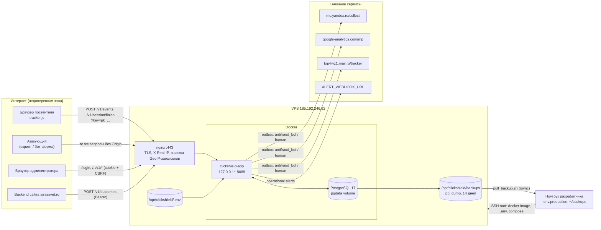

# ClickShield — карта угроз

> Исторический аудит: номера строк и настройки конкретной установки могли измениться.
> Текущие правила эксплуатации — в [SECURITY.md](../SECURITY.md); статусы исправлений
> ниже относятся к указанным в этом документе коммитам.

Дата анализа: 2026-10-04. Основа: код ветки `main` (коммит `f1dd800`) с незакоммиченными изменениями по VK Рекламе, `docker-compose.prod.yml`, `deploy.py`, `scripts/`.

**Главный вывод.** Периметр админ-панели и хранение секретов сделаны аккуратно: bcrypt, HMAC-хэши токенов сессий, SameSite=Strict + CSRF-токен, строгий CSP, AES-256-GCM, параметризованный SQL, экранирование в UI. Основные риски — не во взломе сервера, а в **доверии к данным от браузера**. Всё, что присылает `tracker.js`, полностью контролируется атакующим: поведение, fingerprint, `yclid`/`gclid`/`rb_clickid`, ClientID. Отсюда три наиболее опасных сценария:

1. В режиме `BLOCKING*` атакующий может заблокировать массу реальных посетителей через общий fingerprint (T-01).
2. Бот-ферма может выдавать себя за людей и генерировать «человеческие» конверсии в Метрику, GA4 и VK. Тогда рекламные алгоритмы начнут оптимизироваться на ботов (T-02).
3. Публичный API ingestion позволяет заполнить диск PostgreSQL и вывести сервис из строя (T-05).

---

## 1. Обзор системы

| Компонент | Где в коде | Назначение |
|---|---|---|
| `tracker.js` | `internal/httpapi/assets/tracker.js` | Собирает поведение в браузере посетителя, отправляет батчи и `sendBeacon` |
| Публичный API | `internal/httpapi/public.go` | `POST /v1/events`, `POST /v1/session/finish`, CORS, валидация, rate limit |
| API результатов заявок | `internal/httpapi/outcomes.go` | `POST /v1/outcomes`, Bearer `OUTCOME_API_TOKEN` (вызывает backend сайта) |
| Админ-панель и admin API | `internal/httpapi/auth.go`, `admin.go`, `assets/admin.*` | Логин, проекты, интеграции, сессии, разметка, CSV-экспорт |
| Feature engine и scoring | `internal/feature`, `internal/scoring` | Признаки и rule-based классификация `HUMAN/SUSPICIOUS/BOT/KNOWN_BOT` |
| Каталог ботов, ASN | `internal/bots`, `internal/asn` | Распознавание ботов по UA и IP-диапазонам, ASN по iptoasn |
| Фоновые воркеры | `internal/service/service.go` | Финализация сессий, outbox-доставка, очистка, мониторинг, alert webhook |
| Отправщики интеграций | `internal/integration/*.go` | Yandex Measurement Protocol, GA4 MP, VK офлайн-события |
| PostgreSQL | `internal/store`, `migrations/` | События, сессии, классификации, outbox, секреты, audit log |
| Инфраструктура | `deploy.py`, `docker-compose.prod.yml`, `scripts/` | nginx + TLS, Docker, бэкапы, выгрузка бэкапа на машину разработчика |

### Активы

| Актив | Ценность | Где хранится |
|---|---|---|
| Учётные данные админа, сессии админа | Полный контроль над системой | `.env.production`, `admin_users` (bcrypt), `admin_sessions` (HMAC) |
| `ENCRYPTION_KEY`, `SESSION_SECRET`, `POSTGRES_PASSWORD`, `OUTCOME_API_TOKEN` | Расшифровка секретов, подделка сессий, доступ к БД | `.env.production` локально и `/opt/clickshield/.env` на сервере |
| Токен Yandex MP, GA4 API secret | Запись событий в аналитику от имени владельца | `integrations.secret_encrypted` (AES-GCM) |
| Персональные данные посетителей | Юридический риск (152-ФЗ), репутация | `sessions`, `visitors`, `raw_events`, бэкапы, CSV-экспорт |
| Целостность классификаций | На них опирается решение о блокировке и оптимизация рекламы | `classifications`, outbox, внешняя аналитика |
| Доступность сбора | Без неё нет данных о трафике | Go-сервис, PostgreSQL, диск VPS |
| Правила scoring | Знание порогов упрощает обход | `scoring_config` проекта, код в открытом `tracker.js` |

### Границы доверия

- **TB1. Интернет → nginx → Go.** Публичные эндпоинты доступны всем. Ключ проекта публичный и виден в HTML.
- **TB2. Браузер посетителя → данные.** Содержимое батча полностью контролирует клиент.
- **TB3. Админ-браузер → admin API.** Cookie-сессия + CSRF-токен.
- **TB4. Backend сайта → `/v1/outcomes`.** Общий Bearer-токен.
- **TB5. Go → внешние API.** Метрика, GA4, VK, alert webhook.
- **TB6. Go ↔ PostgreSQL.** Docker-сеть, `sslmode=disable`.
- **TB7. Машина разработчика ↔ прод.** SSH под `root`, сборка образа локально, бэкапы приходят на ноутбук.

---

## 2. Потоки данных и точки входа

### Точки входа

| # | Точка входа | Аутентификация | Ограничения |
|---|---|---|---|
| E1 | `GET /tracker.js`, `/assets/*`, `/healthz`, `/login` | нет | статические файлы из `embed` |
| E2 | `POST /v1/events?key=` | публичный ключ проекта | CORS только при наличии `Origin`; 600 запросов/мин на пару проект+IP; 256 КБ, до 200 событий |
| E3 | `POST /v1/session/finish?key=` | публичный ключ + совпадение `visitor_key` | тот же лимит, 32 КБ |
| E4 | `POST /v1/outcomes` | общий Bearer `OUTCOME_API_TOKEN` | constant-time сравнение, 16 КБ, без rate limit |
| E5 | `POST /login` | логин/пароль | 10 попыток / 15 мин на IP, лимит в памяти |
| E6 | `/v1/*` (admin) | cookie `clickshield_session` (12 ч) + `X-CSRF-Token` для изменений | одна роль, без MFA |
| E7 | SSH на VPS | ключ `root` | `StrictHostKeyChecking=yes` |
| E8 | Сборка образа | — | `golang:1.27-alpine`, `alpine:3.22` без digest; ASN-база скачивается при сборке |

---

## 3. Модель нарушителей

| ID | Нарушитель | Возможности | Цель |
|---|---|---|---|
| N1 | **Кликфродер / бот-ферма** | Headless-браузеры, резидентные прокси, IPv6-пулы, чтение открытого `tracker.js` | Скликать бюджет и не попасть в `BOT`, получить «человеческие» конверсии |
| N2 | **Недобросовестный конкурент** | Скрипты, знание публичного ключа из HTML сайта | Блокировать реальных клиентов, испортить аналитику и обучение рекламных алгоритмов |
| N3 | **Внешний атакующий без цели** | Сканеры, брутфорс, DoS | Захват админки, вывод сервиса из строя |
| N4 | **Атакующий с доступом к инфраструктуре** | Компрометация VPS, ноутбука разработчика, бэкапа или CI | Кража ПДн и секретов, подмена образа |
| N5 | **Внутренний пользователь** | Легитимный доступ к админке | Выгрузка ПДн, ошибочная или злонамеренная разметка |
| N6 | **Поставщик данных или зависимостей** | iptoasn, списки IP ботов, Docker Hub, Go-модули | Подмена данных классификации, внедрение кода |

---

## 4. Карта угроз (STRIDE)

Оценка: **В** — высокий, **С** — средний, **Н** — низкий риск (вероятность × ущерб с учётом текущих мер).

### 4.1. Публичный API ingestion (`/v1/events`, `/v1/session/finish`)

| ID | STRIDE | Угроза | Текущие меры | Риск |
|---|---|---|---|---|
| T-01 | D / T | **Массовая блокировка реальных посетителей по fingerprint.** `Decision` возвращает `BLOCK`, если хоть одна сессия за 30 дней с тем же fingerprint помечена `BOT` (`internal/store/ingest.go:113`). Fingerprint — хэш UA, экрана, языка, часового пояса, ядер, памяти и touch points (`tracker.js:102`). У всех iPhone одной модели и версии iOS в часовом поясе Москвы он одинаковый. Конкурент шлёт несколько «бот-сессий» с таким fingerprint, и в режиме `BLOCKING`/`BLOCKING_BOTS` блокируется значительная часть мобильной аудитории. То же происходит и без атаки: ложное срабатывание на одного посетителя распространяется на всех с таким же устройством. | Режим по умолчанию — `MONITORING`. Блокировка выполняется только на клиенте. | **В** (в режимах BLOCKING*) |
| T-02 | S / T | **Подделка «человеческого» поведения и конверсий.** Правила и признаки видны в `tracker.js`. Бот генерирует правдоподобные mousemove, scroll и active time, получает `HUMAN`, и `antifraud_human` уходит в Метрику, GA4 и VK по его `yclid`/`gclid`/`rb_clickid`. Если `antifraud_human` используется как цель или сегмент оптимизации, рекламная система начинает закупать больше такого трафика. | Детект automation-флагов, ASN хостингов, каталог ботов, velocity-признаки. | **В** |
| T-03 | T | **Отравление внешней аналитики чужими идентификаторами.** `yandex_client_id`, `google_client_id`, `rb_clickid` и `yclid` берутся из батча без проверки. Атакующий подставляет чужие ClientID или click ID с бот-поведением, и ClickShield пишет `antifraud_bot` / user property `antifraud_classification=BOT` на реальных пользователей. Если по этим аудиториям настроены исключения, легитимные пользователи исчезают из рекламы. | Формат ClientID проверяется регуляркой (`public.go:17-18`). | **С** |
| T-04 | I | **Оракул классификации.** В режимах `BLOCKING*` ответ `/v1/events` содержит `decision` (`ALLOW`/`BLOCK`), а tracker публикует `window.ClickShield.getDecision()` и событие `antifraud:decision`. Атакующий подбирает поведение, пока не получит `ALLOW`. | В `MONITORING` и `NOTIFY` всегда возвращается `MONITOR` (`ingest.go`, `Decision`). | **С** (только в BLOCKING*) |
| T-05 | D | **Исчерпание диска и нагрузки на PostgreSQL.** Лимит 600 запросов/мин действует на пару проект+IP. С одного IP можно отправить до 120 000 событий в минуту, с IPv6 /64 или прокси-пула — без ограничения. Каждое событие — строка `raw_events` с JSONB, хранится 7 дней. Глобального лимита, квоты на проект и ограничения на число сессий нет. | `MaxBytesReader` 256 КБ, `client_max_body_size 300k`, TTL сырых событий. | **В** |
| T-06 | D | **Запросы с неверным ключом не ограничиваются.** `publicProject` обращается к БД до проверки rate limit (`public.go:112`), поэтому поток запросов со случайными `key` нагружает пул соединений. | Нет. | **С** |
| T-07 | S | **CORS-список не защищает от подделки.** `setCORS` пропускает запросы без `Origin` (`public.go:127`), а ключ публичный. Любой серверный скрипт отправляет данные в проект. Это ожидаемо для публичного трекера, но allowed origins не стоит считать мерой безопасности. | Документировано, что ключ не секрет. | **С** (как фактор для T-01…T-05) |
| T-08 | T | **Подмена IP и GeoIP-заголовков.** При `TRUST_PROXY_HEADERS=true` доверяются `X-Real-IP`, `X-GeoIP-ASN`, `CF-ASN`, `CF-IPCountry` (`public.go:60`). Это безопасно, пока nginx перезаписывает их (так сделано в `deploy.py`). Если сервис окажется за другим прокси или порт 18088 станет доступен напрямую, атакующий подменит IP и ASN и обойдёт лимиты и признаки хостинга. | nginx очищает заголовки; порт привязан к `127.0.0.1`. | **Н** |
| T-09 | T | **Вмешательство в чужую сессию.** `session_id` генерирует клиент. Перезапись чужой сессии требует совпадения `project_id` и `visitor_key` (`ingest.go:51`), а оба UUID случайны. | Проверка владельца сессии. | **Н** |
| T-10 | I | **Утечка внутренних деталей в ошибках.** Текст ошибки JSON-декодера возвращается клиенту (`public.go:51`). | Ограниченный объём информации. | **Н** |
| T-11 | D | **Рост памяти лимитеров.** Карта `limiter.entries` чистится только от истёкших записей (`server.go:62`). При большом числе IP за одно окно она растёт без верхней границы. Лимиты живут в памяти и сбрасываются при рестарте. | Окно 1 мин / 15 мин. | **Н** |

### 4.2. Аутентификация и админ-панель

| ID | STRIDE | Угроза | Текущие меры | Риск |
|---|---|---|---|---|
| T-12 | S | **Админка доступна из интернета.** `clickshield.airassvet.ru/` и `/v1/*` открыты без IP-allowlist, VPN или MFA. Пароль один, учётная запись одна. Распределённый брутфорс с многих IP обходит лимит «10 попыток на IP». Блокировки по имени пользователя нет. | Пароль `token_urlsafe(32)` из `deploy.py` (фактически не подбирается), bcrypt, rate limit на IP. | **С** (низкий при текущем пароле, растёт при его замене на «человеческий») |
| T-13 | I | **Перебор логинов по времени ответа.** При неизвестном пользователе bcrypt не выполняется (`store/auth.go:49-56`), и ответ приходит заметно быстрее. | Один пользователь `admin`. | **Н** |
| T-14 | S / E | **Кража сессии.** Токен 256 бит, HttpOnly, Secure, SameSite=Strict, срок 12 ч. Привязки к IP или UA нет, idle-таймаута нет, сессии не сбрасываются при смене пароля (`EnsureAdmin` меняет только хэш). | Хранится HMAC токена, logout удаляет сессию. | **Н** |
| T-15 | T | **CSRF.** Изменяющие запросы требуют `X-CSRF-Token`, cookie SameSite=Strict, у `/login` проверяется Origin. Сравнение токена не constant-time (`auth.go:97`), но для CSRF-токена это несущественно. | Есть. | **Н** |
| T-16 | T / E | **Stored XSS через данные трекера.** UA, URL, UTM, fingerprint и bot name попадают в `innerHTML` админки. Все значения проходят через `esc()`, а CSP `script-src 'self'` блокирует inline-скрипты. Риск возникнет, если в новом коде забудут `esc()`. | `esc()`, строгий CSP, `X-Frame-Options: DENY`. | **Н** |
| T-17 | R | **Неполный аудит.** Логируются логин, изменения проектов, интеграций и разметки. Не логируются CSV-экспорт всех сессий, просмотр карточек сессий и неудачные попытки входа. | Таблица `audit_log`. | **С** |
| T-18 | I | **Массовая выгрузка ПДн.** `GET /v1/sessions/export.csv` выгружает все сессии без лимита (`admin.go:349`): IP, fingerprint, ClientID, click ID. Украденная сессия админа превращается в полный дамп ПДн одним запросом. | Защита от CSV-инъекций (`safeCSVCell`). | **С** |
| T-19 | E | **Нет разделения ролей.** Любой админ меняет интеграции, режим блокировки и правила scoring. | Одна учётная запись. | **Н** (сейчас) |

### 4.3. API результатов заявок (`/v1/outcomes`)

| ID | STRIDE | Угроза | Текущие меры | Риск |
|---|---|---|---|---|
| T-20 | S | Один глобальный токен на все проекты. `project_id` необязателен, поэтому при утечке токена можно привязывать заявки к сессиям любого проекта и искажать отчёт о качестве. | Constant-time сравнение, токен 48 байт. | **Н** |
| T-21 | I | `err.Error()` возвращается клиенту (`outcomes.go:36, 74`). Возможна утечка текста ошибок PostgreSQL. | Только для владельца токена или админа. | **Н** |
| T-22 | D | Нет rate limit. | Требуется токен. | **Н** |

### 4.4. Интеграции и исходящие запросы

| ID | STRIDE | Угроза | Текущие меры | Риск |
|---|---|---|---|---|
| T-23 | I | **Утечка токенов интеграций.** Yandex MP token и GA4 API secret зашифрованы AES-256-GCM. Ключ лежит в `.env` на том же сервере, поэтому шифрование защищает только от утечки дампа БД или бэкапа, но не от компрометации VPS. GA4 secret передаётся в query string и может попасть в логи прокси, если они появятся. | Секреты не уходят на фронт, ответы провайдеров редактируются (`[REDACTED]`), `safeTransportError` убирает URL. | **С** |
| T-24 | T | **Подмена outbox.** Злоумышленник с доступом к БД может отправить произвольные события в аналитику от имени владельца. | Изоляция БД в Docker-сети. | **Н** |
| T-25 | I | **Alert webhook.** URL задаётся только через env, поэтому SSRF из админки нет. В webhook уходят только счётчики. | Да. | **Н** |
| T-26 | D | **Зависимость от провайдеров.** Ошибки Метрики, GA4 и VK увеличивают outbox. | Экспоненциальные ретраи, мониторинг > 1 ч. | **Н** |

### 4.5. Классификация и данные классификации

| ID | STRIDE | Угроза | Текущие меры | Риск |
|---|---|---|---|---|
| T-27 | T | **Обход rule-based scoring.** Правила детерминированы, признаки видны в открытом tracker. Атака описана в T-02. Дополнительно бот может слать `automation: {}` и подделывать `device`. | Серверные признаки: ASN, каталог IP ботов, velocity, UA. | **В** (совпадает с T-02) |
| T-28 | S | **Притворство «известным ботом».** `bots.Identify` присваивает `KNOWN_BOT` по одному User-Agent, без подтверждения IP (`internal/bots/bots.go:340-342`). В режиме `BLOCKING_BOTS` сессии `KNOWN_BOT` не блокируются (`ingest.go:109`). Кликфродер с UA `Googlebot` проходит блокировку, а в статистике выглядит как «безобидный» краулер, а не как скликивание. | В аналитику такой визит уходит как `antifraud_bot` (риск 100). | **С** |
| T-29 | T | **Подмена ASN-базы при сборке.** `wget` iptoasn без проверки контрольной суммы (`Dockerfile:11`). Подменённая база изменит признаки хостинговых сетей. | HTTPS, `gzip -t`. | **Н** |

### 4.6. Хранилище, бэкапы, персональные данные

| ID | STRIDE | Угроза | Текущие меры | Риск |
|---|---|---|---|---|
| T-30 | I | **Бэкапы не зашифрованы.** `pg_dump` хранится 14 дней на том же VPS и 30 дней на ноутбуке разработчика (`~/backups/clickshield`). При потере или краже ноутбука утекают ПДн за полгода (`AGGREGATE_TTL=4320h`). Права 600/700 спасают только от других локальных пользователей. | chmod, проверка SHA-256. | **С** |
| T-31 | I | **Соответствие 152-ФЗ.** Собираются IP, fingerprint, рекламные ID, поведение мыши; данные передаются в Google (трансграничная передача). Нужны основание обработки и согласие или cookie-баннер, а также политика обработки ПДн. Сроки хранения заданы, процедуры удаления по запросу субъекта нет. | TTL сырых событий 7 дней, агрегатов 180 дней. | **С** (юридический) |
| T-32 | D | **Бэкапы на том же диске.** Заполнение диска (T-05) одновременно ломает БД и бэкапы. Копия на ноутбуке спасает данные, но не доступность. | Off-server копия. | **С** |
| T-33 | T | `sslmode=disable` между приложением и БД. Допустимо внутри Docker-сети одного хоста. | Изолированная сеть. | **Н** |

### 4.7. Инфраструктура и цепочка поставки

| ID | STRIDE | Угроза | Текущие меры | Риск |
|---|---|---|---|---|
| T-34 | E | **Ноутбук разработчика — единая точка компрометации.** На нём `.env.production` со всеми секретами, SSH-ключ к `root` на проде, сборка образа (код в прод попадает без CI и подписи) и бэкапы с ПДн. | Права 600 на `.env.production`; `.env*` и `deploy.py` в `.gitignore`. | **В** |
| T-35 | E | **Деплой под `root`.** Тот же VPS обслуживает сайт airassvet.ru: компрометация ключа даёт доступ ко всем сервисам. | StrictHostKeyChecking. | **С** |
| T-36 | T | **Образы и зависимости без pinning по digest** (`golang:1.27-alpine`, `alpine:3.22`, `postgres:17-alpine`). | `go.sum` фиксирует модули. | **Н** |
| T-37 | I | **Секреты в env контейнера** видны через `docker inspect` любому пользователю с доступом к Docker-сокету. | Доступ к сокету = root. | **Н** |
| T-38 | D | **nginx без rate limit и connection limit.** Вся защита от флуда лежит на Go. | `client_max_body_size 300k`. | **С** |
| T-39 | T | **Клиентская блокировка обходится.** `decision` применяется только в браузере (`antifraud:decision`). Бот игнорирует его и отправляет форму напрямую. | README прямо говорит, что для блокировки нужен серверный шлюз. | **С** (если сайт полагается на клиентский BLOCK) |

---

## 5. Подтверждённые в коде слабые места

| # | Риск | Файл | Суть | Связь |
|---|---|---|---|---|
| 1 | В | `internal/store/ingest.go:103-121`, `tracker.js:102` | Блокировка по слабому, коллизионному и подделываемому fingerprint | T-01 |
| 2 | В | `internal/httpapi/public.go:45,89`; `server.go:71` | Лимит только на пару проект+IP, нет глобальных квот | T-05 |
| 3 | С | `internal/httpapi/public.go:112-123` | Обращение к БД до rate limit при неверном ключе | T-06 |
| 4 | С | `internal/httpapi/public.go` → ответ `decision`; `tracker.js:151-154, 196` | Оракул классификации для атакующего в режимах BLOCKING* | T-04 |
| 5 | С | `internal/httpapi/admin.go:338-365` | Неограниченный CSV-экспорт ПДн без записи в аудит | T-17, T-18 |
| 6 | С | `internal/httpapi/auth.go:44` | Лимит входа только по IP, в памяти; нет MFA и allowlist | T-12 |
| 7 | Н | `internal/store/auth.go:49-56` | Перебор логинов по времени ответа | T-13 |
| 8 | Н | `internal/httpapi/auth.go:97` | Не constant-time сравнение CSRF | T-15 |
| 9 | Н | `internal/httpapi/outcomes.go:36,74`; `public.go:51`; `admin.go` (`e.Error()`) | Внутренние ошибки возвращаются клиенту | T-10, T-21 |
| 10 | Н | `internal/store/auth.go:20-47` | Смена пароля через env не завершает активные сессии | T-14 |
| 11 | Н | `internal/httpapi/server.go:53-67` | Карта лимитера без верхней границы | T-11 |
| 12 | Н | `Dockerfile:10-11` | ASN-база без проверки целостности | T-29 |
| 13 | С | `scripts/backup.sh`, `scripts/pull_backup.sh` | Бэкапы с ПДн не зашифрованы | T-30 |
| 14 | С | `internal/bots/bots.go:340-342`, `internal/store/ingest.go:109` | `KNOWN_BOT` по одному UA освобождён от блокировки в `BLOCKING_BOTS` | T-28 |

---

## 6. План мер защиты

Порядок: сначала то, что закрывает риски **В** малыми силами.

### Сразу (до включения режима BLOCKING и до использования `antifraud_human` в рекламе)

1. **Убрать fingerprint из решения о блокировке** (T-01). Блокировать только по `visitor_key` или по связке fingerprint + IP/подсеть + ASN за короткое окно. Либо требовать нескольких BOT-сессий с разных visitor_key с одного IP. Добавить тест: одна BOT-сессия с fingerprint X не даёт `BLOCK` новому visitor с тем же X.
2. **Не использовать `antifraud_human` как цель оптимизации** в Директе, Google Ads и VK (T-02). Использовать только `antifraud_bot` для исключающих аудиторий и `HUMAN` + подтверждённая заявка (`lead_outcomes.QUALIFIED`) как позитивный сигнал. Записать это в README.
3. **Квоты на ingestion** (T-05, T-06, T-38):
   - nginx: `limit_req_zone` по `$binary_remote_addr` для `/v1/events` и `/v1/session/finish`, `limit_conn`;
   - Go: агрегировать IPv6 до /64 в ключе лимитера; лимит на число событий (не запросов); глобальная квота событий на проект в минуту;
   - лимит по IP до поиска ключа проекта и кэш `ProjectByKey` (включая отрицательный результат);
   - алерт по свободному месту на диске и по объёму `raw_events`.
4. **Закрыть админку периметром** (T-12): `allow`/`deny` в nginx для `/`, `/login` и admin `/v1/*` по IP или через VPN/WireGuard. Публичными оставить только `/tracker.js`, `/v1/events`, `/v1/session/finish`, `/v1/outcomes`, `/healthz`.

### В ближайший спринт

5. **Убрать оракул** (T-04): в `MONITORING`/`NOTIFY` уже возвращается `MONITOR`. Для режимов BLOCKING* и блокировки форм — серверный шлюз: backend сайта спрашивает решение по `session_id` с Bearer-токеном, а не доверяет браузеру (T-39).
6. **Шифрование бэкапов** (T-30): `age` или `gpg` с публичным ключом на сервере, приватный ключ — вне ноутбука (например, на аппаратном токене). Отдельный off-site носитель, не на рабочем ноутбуке.
7. **Аудит и экспорт** (T-17, T-18): писать в `audit_log` экспорт CSV (с фильтром и числом строк), неудачные входы, просмотр карточки сессии. Ограничить экспорт периодом или числом строк, по умолчанию маскировать IP (/24) и ClientID.
8. **Аутентификация** (T-12…T-15): выполнять фиктивный `bcrypt.CompareHashAndPassword` для неизвестного пользователя; лимит по имени пользователя; `subtle.ConstantTimeCompare` для CSRF; удалять все `admin_sessions` при смене пароля в `EnsureAdmin`; idle-таймаут около 1 ч; TOTP как второй фактор.
9. **Ошибки наружу** (T-10, T-21): отдавать клиенту обобщённые сообщения, детали писать в лог.
10. **Верификация краулеров** (T-28): считать бота «известным» только при совпадении UA и IP-диапазона (или reverse+forward DNS для Google/Yandex). UA поисковика с чужого IP — признак подделки и повод для `BOT`.

### Плановые улучшения

11. **Анти-подделка поведения** (T-02, T-27): серверные признаки, которые не контролирует клиент — частота сессий на IP, /24 и ASN; согласованность UA и client hints; TLS/JA4-отпечаток из nginx; время между загрузкой `tracker.js` и первым батчем. Рандомизировать часть порогов на проект. Добавить proof-of-work или подписанный nonce при выдаче `tracker.js`, чтобы сессию нельзя было начать без загрузки скрипта.
12. **Проверка ClientID** (T-03): принимать `yandex_client_id`/`google_client_id`/`rb_clickid` только если click ID пришёл в `landing_url` той же сессии. Не отправлять `antifraud_bot` для ClientID, который уже встречался у другого visitor_key.
13. **Деплой и инфраструктура** (T-34…T-37): отдельный непривилегированный пользователь для деплоя (группа `docker`, без root-shell); сборка в CI с подписью образа (cosign) вместо ноутбука; хранение `.env.production` в менеджере секретов; pin образов по digest; SHA-256 для ASN-базы или её сборка отдельным проверяемым артефактом; ключ шифрования вне хоста БД (например, через systemd credentials или KMS).
14. **Ротация секретов** (T-23): процедура перешифровки `integrations.secret_encrypted` при смене `ENCRYPTION_KEY` (версия ключа в шифротексте), ротация `OUTCOME_API_TOKEN`, отдельный токен outcomes на каждый проект (T-20).
15. **152-ФЗ** (T-31): уведомление Роскомнадзора об обработке ПДн, согласие на cookie/трекинг на сайте, учёт трансграничной передачи в GA4, процедура удаления данных по `visitor_key`/IP.

---

## 7. Статус исправлений

Исправлено 2026-10-04, проверено unit-тестами и сквозными проверками на локальном стенде (Docker Compose).

| Угроза | Что сделано | Где |
|---|---|---|
| T-01 | `Decision` блокирует только по `visitor_key`; fingerprint не используется | `internal/store/ingest.go` |
| T-28 | UA проверяемого краулера (Google, Bing, Apple, DuckDuckGo, OpenAI, Perplexity) с адреса вне опубликованных диапазонов получает имя «Поддельный краулер» и категорию `automation`, а не `KNOWN_BOT`; миграция 012 переразмечает старые сессии | `internal/bots/bots.go`, `migrations/012_spoofed_crawlers.sql` |
| T-05, T-06, T-11 | Лимит 600 запросов/мин на адрес до поиска ключа; бюджет 20 000 событий/мин на проект и адрес; IPv6 группируется по /64; кэш ключей проекта на 30 с, включая неизвестные ключи; память лимитеров ограничена | `internal/httpapi/server.go`, `public.go`, `project_cache.go` |
| T-38 | nginx: `limit_req` на `/v1/events`, `/v1/session/finish` и `/login`, `limit_conn` 50 на адрес, `client_body_timeout` | `deploy.py` (вне git) |
| T-12, T-13 | Лимит попыток входа по имени пользователя (50 за 15 мин) в дополнение к лимиту по IP; фиктивная проверка bcrypt для неизвестного пользователя | `internal/httpapi/auth.go`, `internal/store/auth.go` |
| T-14 | Смена `ADMIN_PASSWORD` завершает все сессии админа | `internal/store/auth.go` |
| T-15 | CSRF-токен сравнивается за постоянное время | `internal/httpapi/auth.go` |
| T-17, T-18 | В `audit_log` пишутся неудачные входы и каждый CSV-экспорт (фильтр, число строк, IP) | `internal/httpapi/auth.go`, `admin.go` |
| T-10, T-21 | Ошибки парсера JSON и БД не возвращаются клиенту | `internal/httpapi/public.go`, `outcomes.go` |

Не сделано: IP-allowlist админки (T-12, решение владельца), остальные пункты плана.

## Открытые вопросы

- Используется ли `antifraud_human` как цель или конверсия в Директе или VK? От ответа зависит, насколько реален T-02 прямо сейчас.
- Планируется ли включать `BLOCKING`/`BLOCKING_BOTS` на airassvet.ru и через что именно (клиентский скрипт или серверная проверка)?
- Доступна ли админка кому-то, кроме владельца, и с каких адресов?
- Есть ли у сайта согласие на обработку ПДн, покрывающее fingerprint и передачу в GA4?
